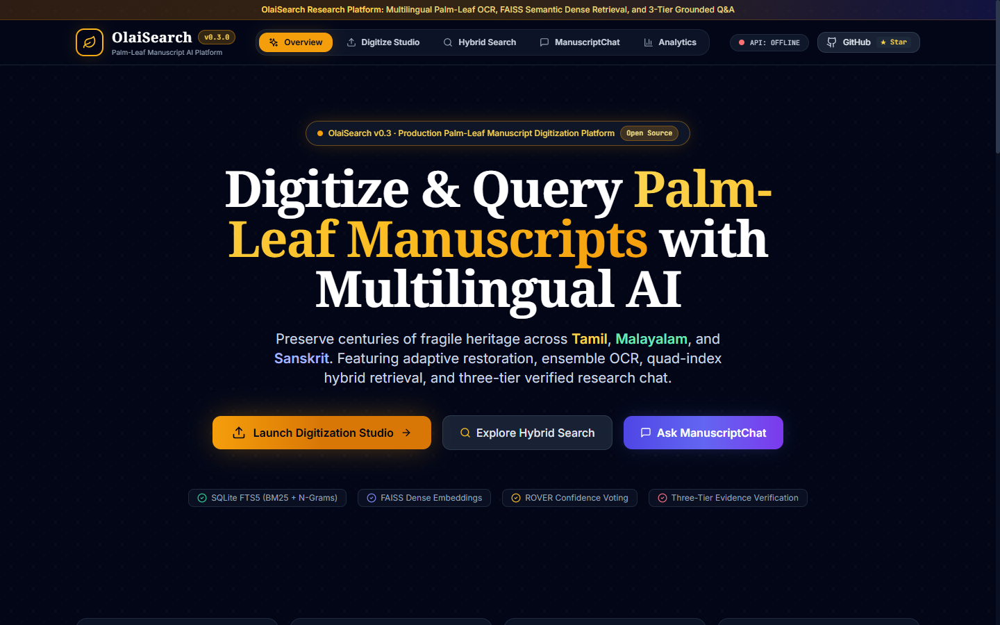

<div align="center">

# 📜 OlaiSearch (ஓலைச்சுவடி)
### Production-Grade Palm-Leaf Manuscript Digitization & Hybrid Retrieval Platform

[](LICENSE)
[](https://akashnarayanan007.github.io/olaisearch/)
[](https://www.python.org/)
[](https://fastapi.tiangolo.com/)
[](https://react.dev/)
[](https://tailwindcss.com/)
[](tests/)

<p align="center">
  <b>A research-grade, multilingual digital humanities platform designed to ingest, restore, segment, transcribe, and query fragile historical palm-leaf manuscripts across Tamil, Malayalam, and Sanskrit.</b>
</p>

[🌐 Live Interactive Demo](https://akashnarayanan007.github.io/olaisearch/) • [Key Features](#-key-features) • [Architecture](#-system-architecture) • [Live UI](#-interface-preview) • [Quick Start](#-quick-start) • [API Reference](#-api-endpoints) • [Evaluation](#-evaluation--benchmarks)

</div>

> [!TIP]
> **🚀 Experience OlaiSearch Live in Your Browser:**  
> Access the interactive web platform directly at **[akashnarayanan007.github.io/olaisearch](https://akashnarayanan007.github.io/olaisearch/)** — test the responsive interface, explore curated historical palm-leaf folios, inspect line-segmentation previews, and try interactive search & chat queries.

---

## 📸 Interface Preview

<div align="center">
  
  <p><em>OlaiSearch v0.3 — Production Landing Page & Ingestion Studio with Vibrant Heritage Design</em></p>
</div>

---

## 🌟 Key Features

### 1. 🔬 Deep Learning & Image Restoration
* **Adaptive Contrast & Binarization**: CLAHE local contrast enhancement, background wood-grain flattening, and Sauvola adaptive thresholding tuned for darkened foliage and aged inks.
* **Projection-Profile Line Segmentation**: Horizontal and vertical projection analysis combined with connected-components to segment irregular, curved palm-leaf text lines.
* **Lightweight Script Classifier**: PyTorch CNN and Unicode heuristic fallback identifying Tamil (`tam`), Malayalam (`mal`), and Sanskrit (`san`, Grantha/Devanagari).

### 2. 🔠 Ensemble Recognition & Philological Post-Correction
* **ROVER Confidence Voting**: Merges Tesseract Indic OCR with Vision-Language Model hypotheses weighted by empirical confidence scores.
* **Historical Lexicon Correction**: Fuzzy Levenshtein matching against classical vocabularies to rectify character confusion (e.g., grantha ligatures and pulli omissions).
* **Date & Entity Normalization**: Resolves Saka, Kali, and Tamil regnal calendar systems into standardized CE dates.

### 3. ⚡ Quad-Engine Hybrid Retrieval with RRF
* **SQLite FTS5 BM25**: Full-text inverted index for precise keyword matching.
* **Character N-Grams (2–4 grams)**: Resilient fuzzy search that retrieves damaged, smudged, or partially fractured words.
* **Phonetic Normalization**: Bridges Roman transliterations and native scripts through ISO 15919 phonetic normalization.
* **FAISS Dense Semantic Search**: Multilingual sentence-transformer vector index (`all-MiniLM-L6-v2`) for conceptual and semantic queries.
* **Reciprocal Rank Fusion (RRF $k=60$)**: Combines sparse and dense score lists without sensitive parameter re-calibration.

### 4. 🛡️ Three-Tier Evidence Grounded Chat
* **Anti-Hallucination Guardrails**: Q&A responses are verified by `CitationVerifier` with strictly separated evidence tiers:
  * 🌿 **Tier 1 (MANUSCRIPT)**: Direct textual evidence extracted from the active physical leaf.
  * 🏛️ **Tier 2 (ARCHIVE)**: Corroborating passages from related corpus manuscripts.
  * 📖 **Tier 3 (BACKGROUND)**: External linguistic, historical, and philological context.

---

## 🏛️ System Architecture

```
                          ┌────────────────────────┐
                          │ Manuscript Folio Image │
                          └───────────┬────────────┘
                                      │
                     ┌────────────────▼────────────────┐
                     │ Preprocessing & Restoration      │
                     │ (CLAHE · Background Flattening) │
                     └────────────────┬────────────────┘
                                      │
                     ┌────────────────▼────────────────┐
                     │ Text Line Segmentation          │
                     │ (Projection Profiles + CC)      │
                     └────────────────┬────────────────┘
                                      │
                     ┌────────────────▼────────────────┐
                     │ Script Identification (CNN)     │
                     └────────────────┬────────────────┘
                                      │
                     ┌────────────────▼────────────────┐
                     │ ROVER Recognition Ensemble      │
                     │ (Tesseract Indic + VLM Fallback)│
                     └────────────────┬────────────────┘
                                      │
                     ┌────────────────▼────────────────┐
                     │ Philological Post-Correction    │
                     │ (Lexicons · ISO 15919 · Dates)  │
                     └────────────────┬────────────────┘
                                      │
            ┌─────────────────────────┴────────────────────────┐
            ▼                                                  ▼
┌───────────────────────┐                          ┌───────────────────────┐
│ SQLite FTS5 Search    │                          │ FAISS Vector Index    │
│ (BM25 + N-Grams + Phonetic)                      │ (Dense Multilingual)  │
└───────────┬───────────┘                          └───────────┬───────────┘
            └─────────────────────────┬────────────────────────┘
                                      │
                     ┌────────────────▼────────────────┐
                     │ Reciprocal Rank Fusion (RRF)    │
                     └────────────────┬────────────────┘
                                      │
                     ┌────────────────▼────────────────┐
                     │ ManuscriptChat & Verifier       │
                     │ (Three-Tier Grounded Evidence)  │
                     └─────────────────────────────────┘
```

---

## 🚀 Quick Start

### Prerequisites
* **Python**: 3.11+
* **Node.js**: 18+ (Node 20+ recommended)
* **Tesseract OCR** (optional for local Indic OCR packs): `tesseract-ocr`, `tesseract-ocr-tam`, `tesseract-ocr-mal`, `tesseract-ocr-san`

---

### Option A: One-Command Startup (Windows PowerShell)

From the project root:

```powershell
# Installs backend & frontend dependencies, then launches both servers
.\build.ps1 dev
```

*The script automatically launches both the FastAPI backend and React Vite dev server in dedicated windows.*

---

### Option B: Manual Startup (Two Terminals)

#### 1. Setup Backend (Terminal 1)
```powershell
# Create environment configuration
Copy-Item .env.example .env

# Install backend package in editable development mode
pip install -e ".[dev]"

# Start FastAPI server
python -m uvicorn backend.main:app --reload --port 8000
```
* Backend API: [http://localhost:8000](http://localhost:8000)
* Swagger Interactive Docs: [http://localhost:8000/docs](http://localhost:8000/docs)

#### 2. Setup Frontend (Terminal 2)
```powershell
cd frontend
npm install
npm run dev
```
* Web Studio UI: [http://localhost:5173](http://localhost:5173)

---

### Option C: Docker Compose

```bash
docker-compose up -d
```
* Access the web application at `http://localhost:5173` and the API at `http://localhost:8000`.

---

## 🧪 Testing & Code Quality

OlaiSearch maintains a strictly tested codebase with automated unit and integration suites:

```powershell
# Run full unit & vertical slice integration test suite (97 tests)
python -m pytest tests/

# Run Python Ruff linter
python -m ruff check backend/ tests/ eval/

# Run frontend ESLint
cd frontend
npm run lint

# Build frontend production bundle
npm run build
```

---

## 📡 API Endpoints

| Method | Endpoint | Description |
|---|---|---|
| `GET` | `/health` | Live system telemetry, database status, and retriever health |
| `POST` | `/api/v1/upload` | Ingest manuscript folio (runs segmentation, OCR, & indexing) |
| `POST` | `/api/v1/search` | Quad-hybrid search across BM25, char n-grams, phonetic, and FAISS |
| `POST` | `/api/v1/chat` | Three-tier evidence grounded Q&A with strict citation verification |
| `POST` | `/api/v1/recognize` | Execute ROVER recognition ensemble on manuscript crops |
| `POST` | `/api/v1/transliterate`| Convert Indic text to standardized ISO 15919 Roman scheme |
| `POST` | `/api/v1/demo/generate`| Generate synthetic degraded manuscript folios for evaluation |
| `GET` | `/api/v1/manuscripts` | Paginated index of cataloged manuscripts and transcribed lines |
| `GET` | `/api/v1/stats` | Aggregate corpus metrics, line counts, and engine statistics |

---

## 📁 Repository Structure

```
olaisearch/
├── backend/
│   ├── main.py                  # FastAPI application entrypoint & lifecycle
│   ├── core/                    # Pydantic schemas, configurations, and logging
│   ├── pipeline/                # Restoration, segmentation, script ID, and OCR
│   │   ├── restoration.py       # CLAHE and Sauvola adaptive binarization
│   │   ├── segmentation.py      # Projection profile text line segmenter
│   │   ├── script_id.py         # PyTorch script identification CNN
│   │   ├── recognition.py       # ROVER confidence voting ensemble
│   │   └── postcorrection.py    # Philological correction and ISO 15919
│   ├── retrieval/               # Hybrid search engine (BM25 + N-gram + FAISS)
│   ├── chat/                    # ManuscriptChat and CitationVerifier
│   ├── storage/                 # SQLite FTS5 database abstraction
│   └── ml/                      # Degradation engine & synthetic data generator
├── frontend/
│   ├── src/
│   │   ├── pages/               # LandingPage, UploadPage, SearchPage, ChatPage, AnalyticsPage
│   │   ├── components/          # ManuscriptViewer and EvidenceCard
│   │   └── api/                 # Axios client helpers
│   ├── tailwind.config.js       # Heritage theme, glowing shadows, & animations
│   └── package.json             # Frontend dependencies
├── tests/                       # 97 unit & integration tests
├── eval/                        # Segmentation, recognition, and retrieval benchmarks
├── docs/                        # Architecture specs, decision records, & assets
├── build.ps1                    # Unified PowerShell build and runner script
└── pyproject.toml               # Python project configuration and linter rules
```

---

## 📜 Citation & License

This project is licensed under the **MIT License** — see the [LICENSE](LICENSE) file for details.

If you utilize OlaiSearch in your digital humanities or document analysis research, please cite:

```bibtex
@software{olaisearch2026,
  author = {OlaiSearch Contributors},
  title = {OlaiSearch: Palm-Leaf Manuscript Digitization and Hybrid Retrieval Platform},
  year = {2026},
  publisher = {GitHub},
  url = {https://github.com/yourusername/olaisearch}
}
```
